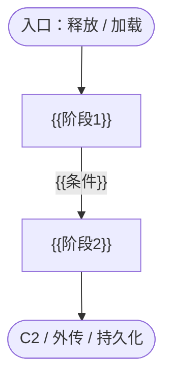
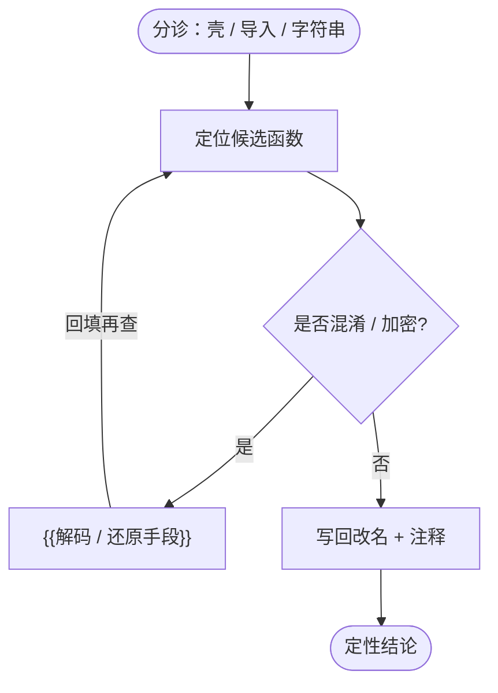
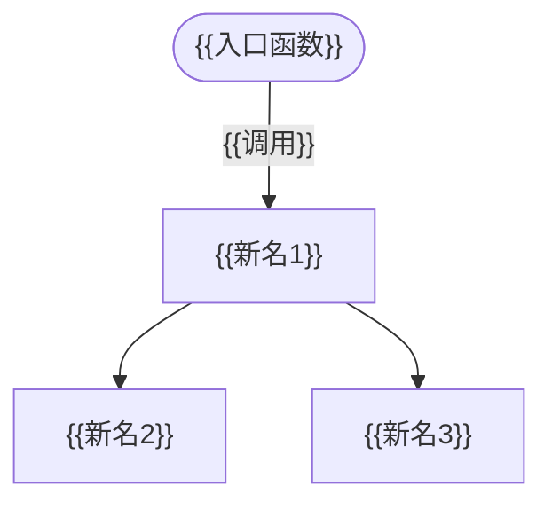

# {{样本名}} 分析记录

- 日期：{{YYYY-MM-DD}}
- 样本：{{文件类型}} · {{架构}} · {{大小}}
- 工具：{{bnsql / idasql / ghidrasql}}（{{CLI / UI}}）
- 定性：{{一两句话}}

## 样本行为总流程

> 只画本会话确认过的行为。

## 分析思路

> 这次怎么从分诊一步步走到结论。

## 分析步骤

1. **{{做了什么}}**：`{{命令}}`，{{关键结果}}

## 关键函数

### 调用关系

> 节点用新名，只连已确认的调用。

| 地址 | 原名 | 新名 | 作用 |
|------|------|------|------|
| `{{0x...}}` | `{{sub_...}}` | `{{新名}}` | {{作用}} |

写回：改名 {{n}} 处，注释 {{n}} 处，类型 {{n}} 处，{{已保存 / 未保存}}。

## 关键字符串与配置

| 内容 | 位置 | 说明 |
|------|------|------|
| `{{...}}` | `{{0x...}}` | {{说明}} |

## 技术点

| 技术点 | ATT&CK |
|--------|--------|
| {{名称}} | `{{Txxxx}}` |

详细记录：[techniques.html](techniques.html)

## 检测规则

- [`{{规则名}}`]({{规则名}}.yar)

## 结论与待办

{{结论}}

- {{未完成的分析点}}
